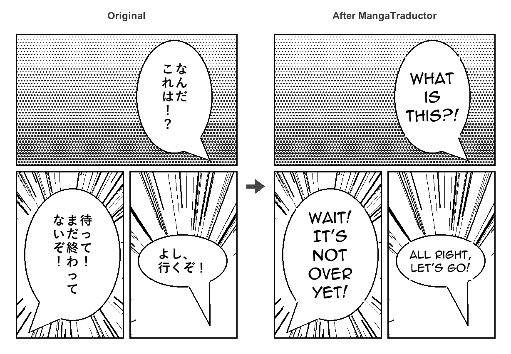

# MangaTraductor

Desktop app and CLI to **OCR Japanese manga speech bubbles, translate them with DeepL and typeset the translation back into the page**.

Select a bubble with the mouse → the text is recognized with a manga-specific OCR model → DeepL translates it → the original text is covered and the translation is drawn at the largest font size that fits.



<sub>Sample page drawn for this README (no copyrighted manga). Each bubble, vertical or horizontal,
was read by the real OCR model and typeset by the app's renderer; the English lines are the
script's reference translations. Regenerate it with `python docs/make_demo.py` (uses DeepL when
a key is configured).</sub>

## Features

**Desktop app**
- Drag a box around a speech bubble to OCR and translate it in the background (the UI never freezes).
- Translate to English, Spanish, Portuguese, French, German or Italian (choice is remembered).
- Edit the translation, or type your own, before drawing it.
- Automatic typesetting: word wrap, binary-searched font size, centered text; over-long words are split instead of overflowing.
- Multi-level undo (`Ctrl+Z`), zoom, fit-to-width, smooth accelerated scrolling (hold `W`/`S`).
- Folder navigation in natural order (`page2` before `page10`) with `A`/`D` or the arrow keys.
- Shortcuts are disabled while you type in a text box.

**Command line**
- Batch OCR + translation of cropped bubbles from files or folders.
- Export results to JSON or CSV (CSV opens correctly in Excel with Japanese text).
- `check-key` command to diagnose DeepL API key problems.

**Both**
- Translation cache: a line already translated to the same language is reused instead of
  being sent to DeepL again, so re-running a chapter does not use up your character quota.

## Installation

Requires Python 3.10+.

```bash
git clone https://github.com/Gonder301/MangaTraductor.git
cd MangaTraductor
pip install -e ".[ocr]"
```

The `ocr` extra installs PyTorch and Transformers. The OCR model
([`kha-white/manga-ocr-base`](https://huggingface.co/kha-white/manga-ocr-base)) is downloaded
automatically the first time it is used.

## DeepL API key

Translation needs a DeepL API key (the [free tier](https://www.deepl.com/pro-api) works). Either:

- click **API Key Settings** in the app, or
- set the `DEEPL_API_KEY` environment variable (it takes precedence).

The key is stored in your user settings file, never inside the repository:
`%APPDATA%\mangatraductor\config.json` on Windows, `~/.config/mangatraductor/config.json` elsewhere
(override with `MANGATRADUCTOR_CONFIG`). Without a key you can still OCR and type translations manually.

### Translation cache

Successful translations are saved in `translations.json` next to the settings file, keyed by
the Japanese text and the source/target languages. Errors are never cached, and the oldest
entries are dropped after 20,000 lines. To skip the cache for one run use `--no-cache`; to empty
it use `mangatraductor clear-cache` or **API Key Settings → Clear translation cache** in the app.

## Usage

### Desktop app

```bash
mangatraductor-gui            # or: python manga_translator_app.py
```

1. **Open Image** (`Ctrl+O`) and pick a page; the rest of the folder becomes navigable.
2. Drag a box around a speech bubble. The OCR text and translation appear on the right.
3. Optionally edit the translation, then click **Replace Text in Image**.
4. **Save Image** (`Ctrl+S`).

### Command line

Each image must contain **one cropped speech bubble** (the OCR model reads single bubbles, not full pages).

```bash
mangatraductor ocr bubbles/ --target-lang ES --output results.csv
mangatraductor ocr bubble1.png bubble2.png --no-translate
mangatraductor ocr bubbles/ --no-cache      # ask DeepL again even for cached lines
mangatraductor check-key
mangatraductor clear-cache
```

`python run_ocr.py` still processes every image in `./images` as before.

## Project structure

```
mangatraductor/
  gui.py        Tkinter app; OCR/translation run in worker threads, UI updates go through a queue
  cli.py        argparse CLI: batch processing, JSON/CSV export, key check
  ocr.py        lazy wrapper around the manga-ocr model + text post-processing
  translate.py  DeepL client with timeouts and readable error messages
  cache.py      thread-safe, on-disk translation cache shared by the GUI and the CLI
  render.py     selection mapping, word wrap, font fitting and drawing (pure Pillow)
  config.py     settings file and API key resolution
  files.py      image discovery and natural sorting
tests/          pytest suite (runs without PyTorch; GUI test is skipped without a display)
docs/           make_demo.py draws a sample page and builds the README image with the real model
```

## Development

```bash
pip install -e ".[dev]"
pytest
ruff check .
```

CI runs lint and tests on Python 3.10, 3.12 and 3.13 for every push.

## Limitations and roadmap

- [ ] Automatic speech-bubble detection, so full pages can be processed in one click.
- [ ] Inpainting instead of a white box, to preserve screentones behind the text.
- [ ] Vertical text layout and per-bubble font/color options.
- [ ] Batch typesetting of a whole chapter from the CLI.
- [x] Translation cache to avoid paying twice for repeated lines.

## Credits

- OCR model: [manga-ocr](https://github.com/kha-white/manga-ocr) by kha-white.
- Translation: [DeepL API](https://www.deepl.com/pro-api).
- Font: Anime Ace 2.0 by Blambot (see Blambot's license terms before redistributing).
